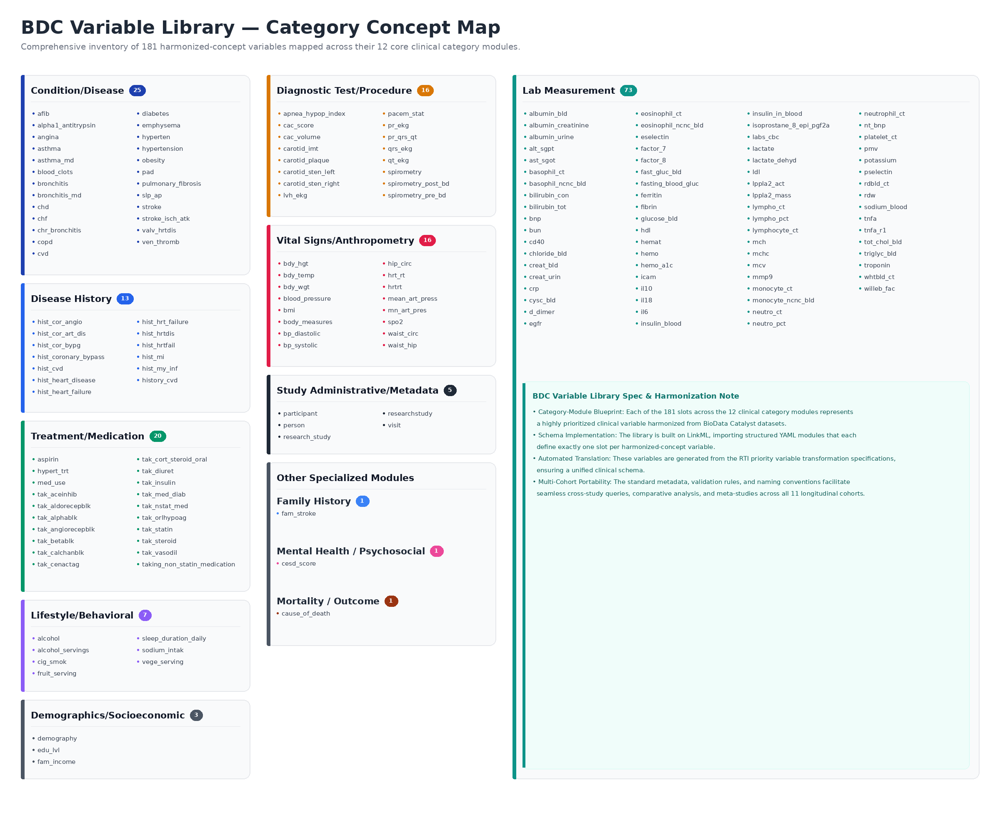

# BDC-VarLib

**BDC Variable Library** — a [LinkML](https://linkml.io/)-based variable
library for [BioData Catalyst](https://biodatacatalyst.nhlbi.nih.gov/)
datasets. It re-organizes study-by-study transform specs into one slot per
harmonized clinical concept, grouped into category modules spanning the
contributing BioData Catalyst studies.

📖 **Documentation (current variable/category/study counts):** [tis-lab.github.io/BDC-VarLib](https://tis-lab.github.io/BDC-VarLib)

🔗 **Source data:** generated from RTI International's
[NHLBI-BDC-DMC-HV / priority_variables_transform](https://github.com/RTIInternational/NHLBI-BDC-DMC-HV/tree/main/priority_variables_transform)

## Structure

- `bdc_varlib.yaml` — umbrella schema; imports every category module.
- `bdc_varlib_common.yaml` — enums shared across categories, so each module
  is self-contained and loadable on its own.
- `bdc_varlib_<category>.yaml` — one module per category (Condition/Disease,
  Lab Measurement, Treatment/Medication, ...). See the
  [documentation site](https://tis-lab.github.io/BDC-VarLib) for the full
  module breakdown and per-category variable coverage.

## License

Apache-2.0
