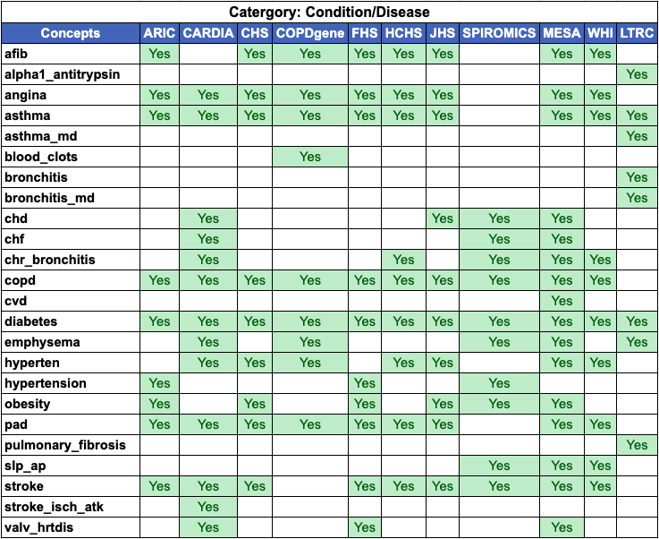
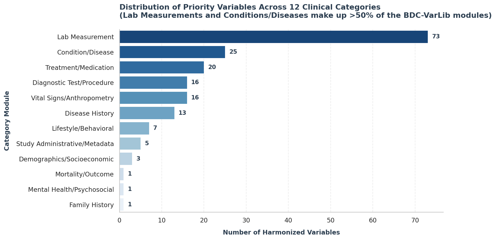
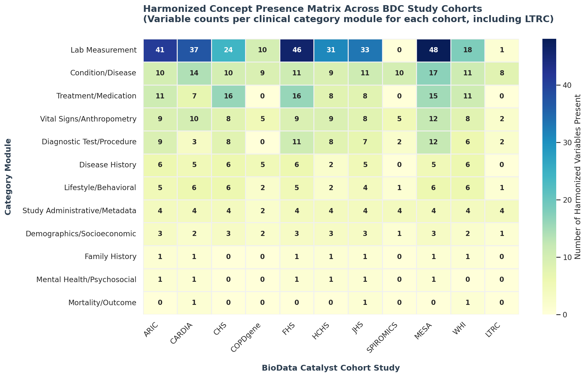

# About BDC Variable Library

A LinkML-based variable library for BioData Catalyst datasets.

## Background

BDC Variable Library (BDCVL) clusters related variables into a single
LinkML slot per concept, so `afib` is one slot with a comma-delimited
`source_study` / `dataset_accession` / `variable_accession` annotation
rather than separate near-duplicate records per study. These concepts are
in turn clustered into category modules, such as Condition/Disease, Lab
Measurement, and Treatment/Medication, spanning all contributing BioData
Catalyst studies.

## Example: the Condition/Disease category

Each category module is a LinkML class whose slots are its concepts. Here's
what that looks like for `ConditionDisease` — every concept as a row, every
contributing cohort as a column:



Reading this: `afib` is contributed by 9 of the 11 cohorts (CARDIA and
SPIROMICS don't have it); `alpha1_antitrypsin` and `bronchitis_md` are
LTRC-only, introduced when LTRC was added as an 11th study; `cvd` comes from
MESA alone. Every other category module (Lab Measurement, Treatment/
Medication, ...) follows the same shape — see the [Schema](elements/index.md)
tab to browse any of them directly.

## Concepts per category

And the same data collapsed one level further — total concept count per
category, independent of cohort:



Lab Measurement and Condition/Disease together account for over half the
library; five categories (Family History, Mental Health/Psychosocial,
Mortality/Outcome, Demographics/Socioeconomic, Study Administrative/
Metadata) are intentionally small — they reflect how many *distinct*
harmonized concepts the source repo defines in that category, not how
important the category is.

## Concept coverage across all categories

The same idea, rolled up: how many concepts *per category* each cohort
contributes, across all 12 category modules at once.



A few things stand out here: Lab Measurement dominates for the cohorts with
deep biomarker panels (FHS at 46, MESA at 48); SPIROMICS is the one cohort
with zero Lab Measurement and zero Treatment/Medication concepts, unusual
since every other cohort has double digits in Lab Measurement — consistent
with SPIROMICS being a COPD-focused imaging/spirometry study rather than a
biomarker-heavy cardiovascular cohort, while it still contributes 10
Condition/Disease and 5 Vital Signs/Anthropometry concepts; and LTRC, being
the newest addition, only shows up meaningfully in Condition/Disease (8) and
Study Administrative/Metadata (4) so far.

## From category → concept → variable

The library has three levels, and it's worth being explicit about what each
one is:

| Level | LinkML construct | Example | What the three figures above show |
|---|---|---|---|
| **Category** | class | `ConditionDisease` | the bar chart, and the rows of the heatmap |
| **Concept** | slot | `afib` | the rows of the Condition/Disease table, and the heatmap's cell counts |
| **Variable** | annotation entries on a slot | one real dbGaP `phv`/`pht` pair | *not visualized above* — see below |

A concept's slot doesn't stop at "which cohorts have it" — every
contributing cohort can have *multiple* real dbGaP variables behind it (one
per exam wave, hospital form, or follow-up survey that captured the same
concept). Those are recorded as comma-delimited lists in the slot's
annotations, not exploded into separate slots. For `afib` specifically:

```yaml
afib:
  title: afib
  description: CLINICAL_DIAGNOSIS; PATIENT_SELF-REPORTED_CONDITION
  range: ConditionStatusEnum
  annotations:
    bdchm_class: Condition
    source_study: ARIC, CHS, COPDGene, FHS, HCHS, JHS, MESA, WHI
    dataset_accession: pht004037, pht004038, pht004039, ... # 79 datasets total
    variable_accession: phv00203303, phv00203306, phv00203309, ... # 103 variables total
```

That one slot represents **79 real dbGaP datasets and 103 real dbGaP
variables**, pooled from 8 cohorts, into a single harmonized `afib` concept.
Across all 181 concepts in the library, this is the norm rather than the
exception for any concept collected across multiple exam cycles.

There's no separate "variables" visual here on purpose — with 181 concepts
each potentially backed by dozens of accessions, a chart at that resolution
would just be the schema files themselves. The right way to explore that
level is the [Schema](elements/index.md) tab, where every concept's slot
page lists its full, real `dataset_accession` / `variable_accession` lists.

## Structure

- `bdc_varlib.yaml` — the umbrella schema; imports every category module.
- `bdc_varlib_common.yaml` — enums shared across categories (e.g.
  `ConditionStatusEnum`), so every category module is self-contained and can
  be loaded standalone, not only via the umbrella.
- `bdc_varlib_<category>.yaml` — one module per biomedical category
  (Condition/Disease, Lab Measurement, Treatment/Medication, ...); see the
  [Home page](index.md) for the full module list.

## Provenance

Every variable's `annotations` record exactly which studies, dbGaP datasets
(`pht`), and dbGaP variables (`phv`) it was derived from, so any slot can be
traced back to its source transform file. Where a real ontology mapping
exists in the source data (MONDO for conditions, RxCUI for medications, OMOP
for coded categorical values), it's carried through as a real LinkML
`exact_mappings` entry rather than free text.

## Source

Generated from
[RTIInternational/NHLBI-BDC-DMC-HV](https://github.com/RTIInternational/NHLBI-BDC-DMC-HV/tree/main/priority_variables_transform).
