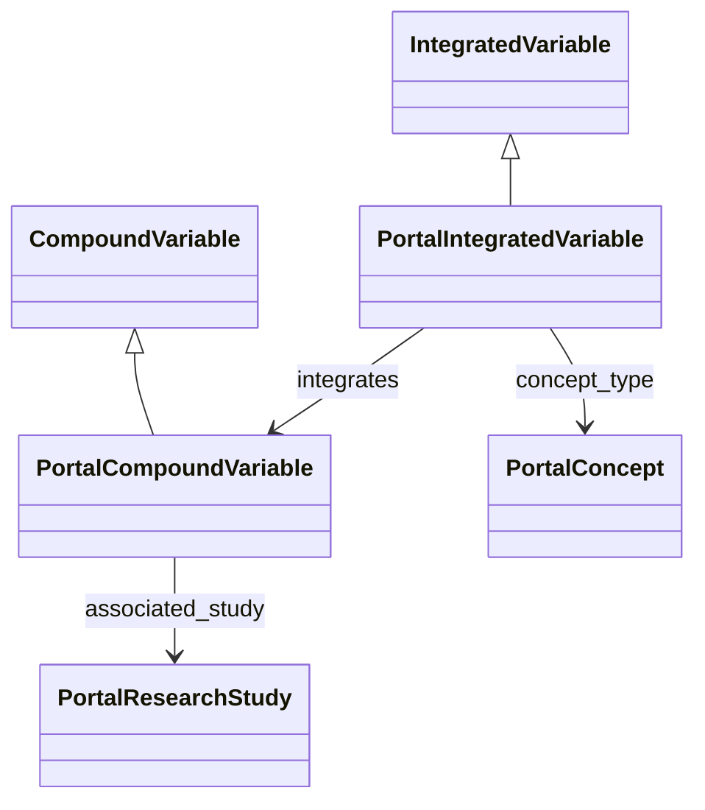

# Portal variable-library contract

## Purpose and scope

This proposal defines the BDC variable metadata consumed by the portal's harmonized concept search. PortalIntegratedVariable extends upstream IntegratedVariable;  PortalCompoundVariable and PortalResearchStudy extend their corresponding upstream classes.
Optional source-variable records extend SingleCategoricalVariable and SingleContinuousVariable. The upstream model and dependencies are pinned for reproducible validation.

[portal-varlib.yaml](portal-varlib.yaml) defines the catalog. [terms-response.yaml](terms-response.yaml) defines its metadata-only search projection. [WIREFRAME-MAPPING.md](WIREFRAME-MAPPING.md) documents supported UI fields, unavailable data
and requirements for serving that data. [validate_catalog.py](validate_catalog.py) validates catalog structure and references; [preview_terms.py](preview_terms.py) provides the executable search demonstration.

The catalog format uses schema_version: 3. This format identifier applies to the catalog and its fixtures. The running middleware consumes a different index format and requires a dedicated loader and response mapper for this contract.

This is a proposal for [BDC-Portal #104](https://github.com/orgs/tis-lab/projects/7/views/9?pane=issue&itemId=270788506&issue=tis-lab%7CBDC-Portal%7C104). Required metadata and authoritative producer artifacts are required to be reviewed before
production adoption.

## Object model

Two integrated variables can describe the same ontology concept. They remain distinct because their IDs and definitions differ. For example, the synthetic fixture contains
a clinical hypertension variable and a reported hypertension variable, both referencing HP:0000822. The concept is the search key; the integrated-variable ID identifies the specific definition. Compound-variable IDs identify contributing study-specific definitions.

Root catalog lists: integrated_variables, compound_variables, studies, concepts, sources. Optional single_continuous_variables and single_categorical_variables hold actual source records; supplied compound row_metadata references must resolve to them. The catalog uses upstream snake_case field names. Java/GraphQL can use camelCase through
an explicit mapper; GraphQL does not automatically understand LinkML inheritance.

## Inherited versus portal-specific fields

| Element                                                | Origin and purpose                                                                                     |
|--------------------------------------------------------|--------------------------------------------------------------------------------------------------------|
| id, variable_label, variable_description, concept_type | Inherited upstream Variable/Entity metadata                                                            |
| bdchm_type, unit, cde_id, integrates                   | Inherited upstream IntegratedVariable slots                                                            |
| integrates -> PortalCompoundVariable                   | Portal narrows the upstream CompoundVariable range to its subclass and requires nonempty ID references |
| associated_study on compound variables                 | Inherited reference; portal requires it and resolves it in root studies                                |
| row_metadata, documentation_metadata                   | Inherited compound-variable metadata; not replaced with file aliases                                   |
| metadata_sources                                       | New portal provenance references attached to both variable subclasses                                  |
| PortalResearchStudy.study_name                         | New display metadata; ID remains inherited from ResearchStudy                                          |
| concepts                                               | Portal lookup for ontology metadata; variable labels are separate                                      |
| schema_version, release, sources and root lists        | Portal artifact envelope                                                                               |

Requiring variable labels, concepts, BDCHM categories, provenance and study references
is proposed **portal policy**, not a statement that upstream requires them. These
constraints need review. The inherited optional associated_study on an integrated
variable remains singular; derive the full contributing-study set through integrates.
The validator does not assume all source concepts or units must equal the integrated
variable's values: a legitimate transformation can change them. Domain review must
establish that transformation's validity.

## Upstream reuse and dependency pinning

The extension imports `vendor/bdc_variable_library.yaml` from [BDC Variable Library](https://github.com/linkml/bdc-variable-library/blob/main/src/bdc_variable_library/schema/bdc_variable_library.yaml). Its two transitive schemas are pinned too:
- [linkml-microschema-profile](https://github.com/linkml/linkml-microschema-profile/blob/main/src/linkml_microschema_profile/schema/linkml_microschema_profile.yaml) (v0.3.0).
- [clinical-microschemas](https://github.com/linkml/clinical-microschemas/blob/main/src/clinical_microschemas/schema/clinical_microschemas.yaml) (v0.0.8).

Only active import paths are relocated to local siblings. Upstream definitions are not
edited. Licenses and hashes are included in [source-manifest.json](source-manifest.json). Tests verify local
hashes and inspect the imported ancestor's from_schema so accidental local redefinition
is detectable.

This makes validation independent of remote schema downloads. It does not make upstream
updates automatic: update the commit/hashes/import closure deliberately, inspect the
upstream diff and rerun tests. Inheritance carries forward the model definitions when
that reviewed update is adopted. Pinning protects deployments from unreviewed drift.
requirements-validation.txt records direct validation tool versions; use the repository's
uv.lock for the complete project environment. Do not independently edit vendored definitions.

### Upstream validation limitation

The imported clinical model contains an invalid regex in StrokeStatusRecord.condition_type:
`^ICD10:(I6[0-9](\.[A-Z0-9]{1,4})?` (unclosed group). The full generated JSON Schema
therefore fails its own schema check. This record is not reachable from PortalVariableCatalog.
The validator retains the complete reference closure of the root before checking generated
JSON Schema; it removes only unreachable definitions, never properties or reachable constraints.
Tests check that inherited DocumentationVariable remains and dangling references fail closed.
Upstream YAML stays unchanged. This is not a claim that the whole upstream clinical model
passes JSON Schema validation. Flag the regex for upstream review; if an invalid constraint
becomes reachable in a future pin, this portal check must fail rather than ignore it.

## What the example proves - and does not prove

[examples/portal-catalog.json](examples/portal-catalog.json) is **synthetic review data**, not an export of approved DMC
IntegratedVariable records. Every example variable/study/source ID is explicitly example:.
The all-zero revision and example repository are placeholders. A fixture requires the
explicit --allow-synthetic switch; normal validation rejects those markers.

The example proves the schema can express multiple variables for one concept, compound
references, study resolution and provenance. It does not validate actual scientific
definitions. Production validation requires an authoritative artifact conforming to this contract.

A publisher must provide real variable/study identities, definitions, integrates links,
labels and metadata provenance. A concept CURIE or transformation-file stem is not enough.
Do not fabricate IDs, zip unrelated CSV lists or infer a study/variable Cartesian product.
The current grouped VarLib files may help discover concepts, but cannot by themselves be
assumed to supply this normalized identity graph. Request the authoritative producer artifact.
